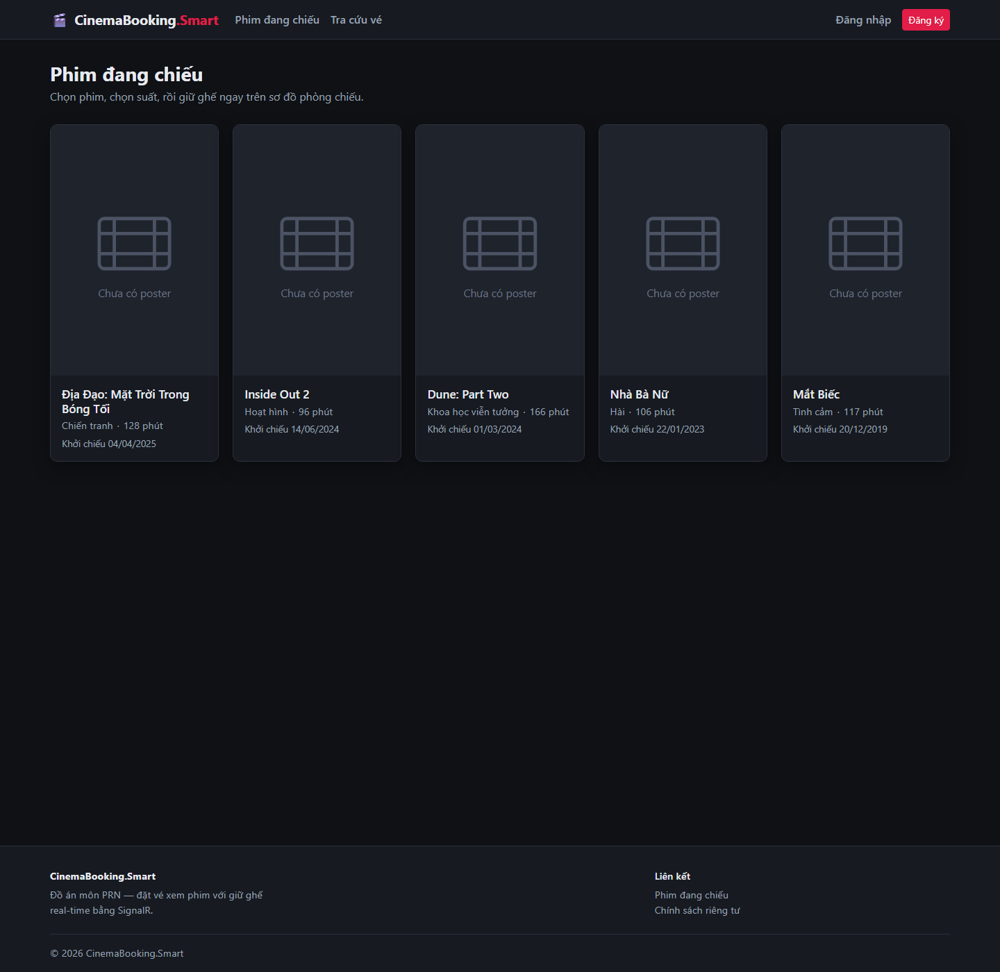
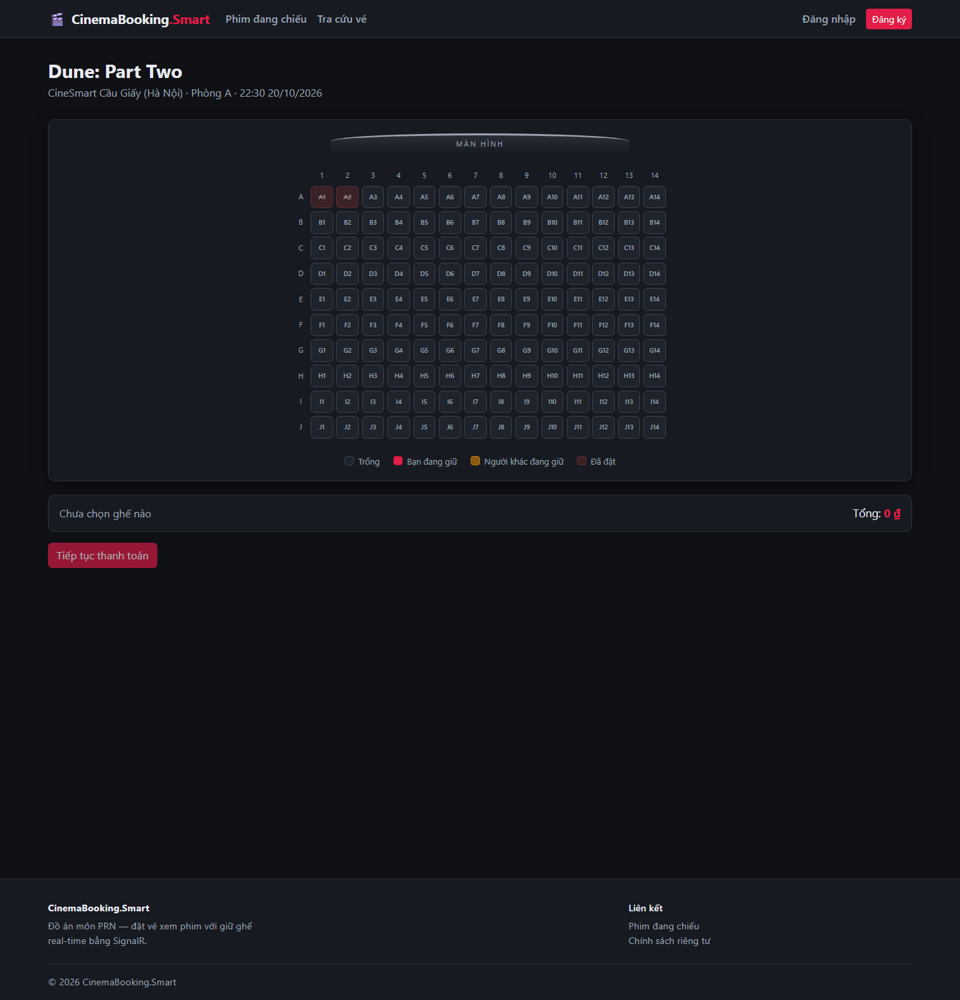
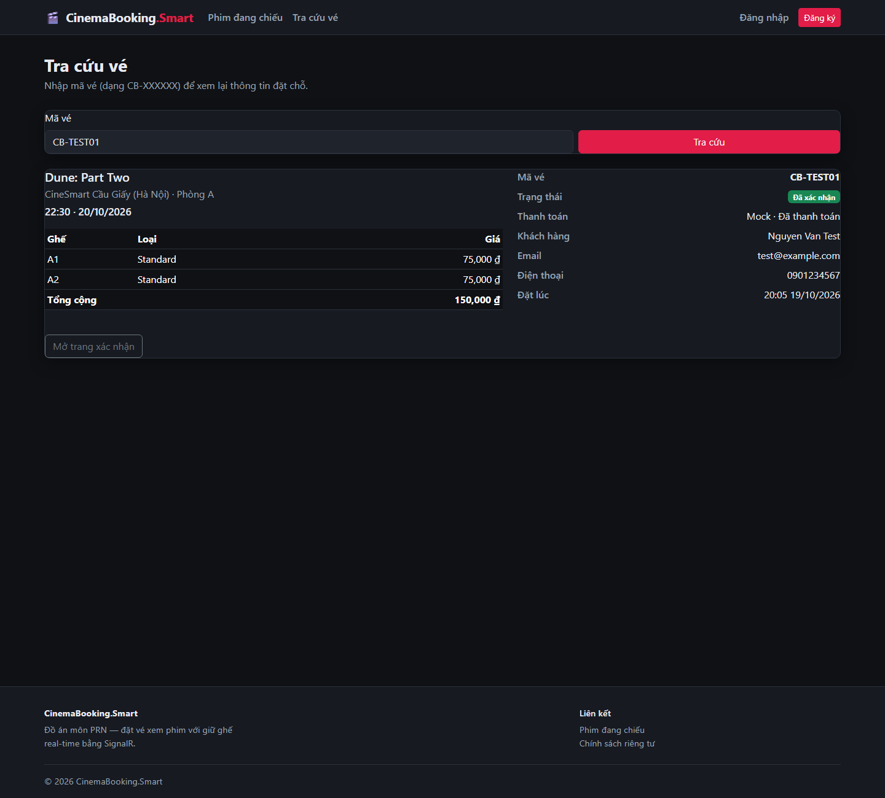
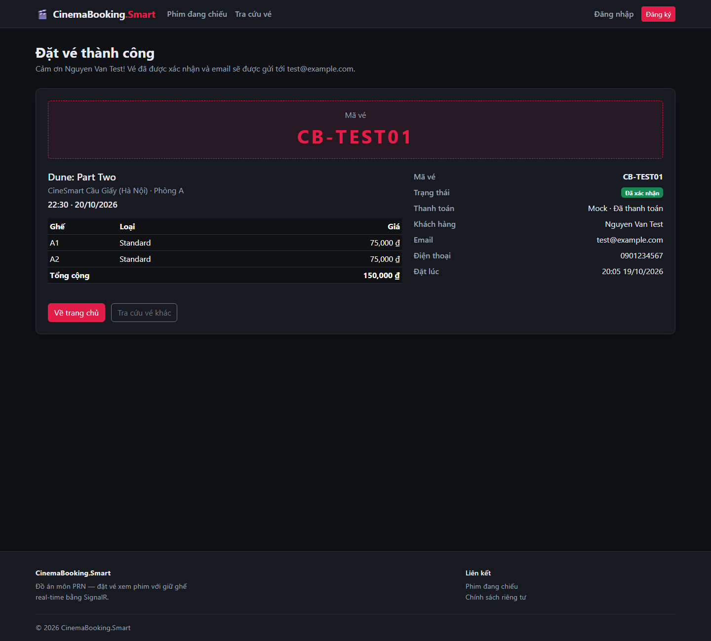

# CinemaBooking.Smart

Hệ thống đặt vé xem phim với **giữ ghế real-time** bằng SignalR.
ASP.NET Core MVC · .NET 9 · EF Core 9 · SQL Server.

- 📄 Đặc tả đầy đủ: [`General.md`](General.md)

---

## Chạy dự án

**Yêu cầu:** .NET SDK 9.0+, SQL Server LocalDB (kèm Visual Studio) hoặc SQL Server.

```bash
# 1. Khôi phục và build
dotnet build

# 2. Chạy web (cửa sổ 1) — tự áp migration và seed dữ liệu mẫu ở lần chạy đầu
dotnet run --project src/CinemaBooking.Web

# 3. Chạy worker (cửa sổ 2)
dotnet run --project src/CinemaBooking.Worker

# 4. Chạy test
dotnet test
```

Không cần chạy `dotnet ef database update` bằng tay: web gọi `Database.MigrateAsync()` rồi
`CatalogSeeder` lúc khởi động, nên `git pull` + `dotnet run` là đủ để có schema và dữ liệu
giống cả nhóm.

Chuỗi kết nối nằm ở `ConnectionStrings:Default` trong `src/CinemaBooking.Web/appsettings.json`.
Muốn đổi cho riêng máy mình thì tạo `appsettings.Development.json` — file này đã bị `.gitignore`
bỏ qua, không commit chuỗi kết nối thật.

### Ba dev đồng bộ database thế nào

**Mỗi người một database riêng trên máy mình, không dùng chung một DB.** Dùng chung sẽ hỏng
đúng Sprint 3: ba người cùng giữ ghế trên một suất chiếu thì không ai phân biệt được bug thật
với người bên cạnh đang click, và không ai chạy được migration khi hai người kia đang mở kết nối.

Thứ được đồng bộ là **schema và dữ liệu mẫu**, đi qua git:

| Cần giống nhau | Đi qua đâu |
| --- | --- |
| Schema | File migration trong `src/CinemaBooking.Infrastructure/Persistence/Migrations/` |
| Dữ liệu mẫu | `CatalogSeeder` (phim, rạp, phòng, ghế, suất chiếu) và `IdentitySeeder` (vai trò, tài khoản) |

**Chỉ Dev A chạy `dotnet ef migrations add`.** Hai người tạo migration song song trên cùng một
gốc sẽ làm `CinemaDbContextModelSnapshot.cs` xung đột và rất mất công gỡ. Ai cần đổi schema thì
báo Dev A.

Làm lại database từ đầu khi dữ liệu bẩn:

```bash
dotnet ef database drop -f -p src/CinemaBooking.Infrastructure -s src/CinemaBooking.Web
dotnet run --project src/CinemaBooking.Web        # tự tạo lại và seed
```

---

## Cấu trúc

| Dự án                              | Vai trò                                                                        |
| ---------------------------------- | ------------------------------------------------------------------------------ |
| `src/CinemaBooking.Domain`         | Entity, enum, interface — không phụ thuộc hạ tầng                              |
| `src/CinemaBooking.Infrastructure` | `CinemaDbContext`, `InMemorySeatLockManager`, `MockPaymentService`, đăng ký DI |
| `src/CinemaBooking.Web`            | MVC controllers, Razor views, `SeatHub` tại `/hubs/seat`, dọn ghế hết hạn (`SeatLockCleaner`, `ExpiredBookingCleaner`) |
| `src/CinemaBooking.Worker`         | `EmailOutboxWorker`, `DailyReportWorker`                                        |
| `tests/CinemaBooking.Tests`        | xUnit                                                                          |

---

## Trạng thái nhánh `feat/s1-c-ui-auth-foundation`

Nhánh này tách từ `master` và **chỉ chứa phần việc của Dev C** (layout, theme, Identity UI,
trang chủ). File migration do Dev A sở hữu, còn nằm ở `feat/s1-a-data-migration-seed` và
chưa merge vào `dev`.

Muốn chạy thử riêng nhánh này thì tự sinh migration ở máy mình:

```bash
dotnet ef migrations add Initial -p src/CinemaBooking.Infrastructure -s src/CinemaBooking.Web -o Persistence/Migrations
dotnet ef database update -p src/CinemaBooking.Infrastructure -s src/CinemaBooking.Web
```

Chưa có `CatalogSeeder` của Dev A thì trang chủ hiện đúng trạng thái "Chưa có phim nào" —
đó là hành vi mong đợi, không phải lỗi view.

### Khi merge vào `dev`

Mọi file khác đều tự merge sạch. Chỉ còn **một** điểm phải gỡ tay, và nó giống nhau với
cả hai nhánh kia: dòng ngay sau `var app = builder.Build();` trong `Program.cs` — cả ba
người đều chèn vào đúng chỗ đó.

**Với nhánh Dev A** (`feat/s1-a-data-migration-seed`) — cùng một việc, gộp lại thành một
scope, **thứ tự bắt buộc là migration → catalog → identity**:

```csharp
using (var scope = app.Services.CreateScope())
{
    var db = scope.ServiceProvider.GetRequiredService<CinemaDbContext>();
    await db.Database.MigrateAsync();
    await CatalogSeeder.SeedAsync(db);
    await IdentitySeeder.SeedAsync(scope.ServiceProvider);
}
```

`IdentitySeeder` phải chạy sau `MigrateAsync` — nó kiểm tra đã có migration nào được áp
chưa và dừng ngay nếu chưa. Sau khi merge xong thì bỏ bước sinh migration thủ công ở trên,
web tự áp migration lúc khởi động.

**Với nhánh Dev B** (`feat/s2-b-catalog-query`) — hai việc không liên quan nhau tình cờ nằm
cùng dòng, giữ cả hai. `UseCinemaExceptionHandling()` phải đứng **trước** vì middleware chỉ
bắt được exception của những middleware nằm sau nó; khối seed đặt sau, thứ tự giữa chúng
không ảnh hưởng gì vì seed chạy xong trước khi `app.Run()` mở cổng.

---

## Tài khoản và vai trò

`IdentitySeeder` chạy lúc khởi động web, tạo hai vai trò `Admin` / `Customer` và một tài khoản
quản trị nếu chưa có. Chạy lại bao nhiêu lần cũng được — mỗi bước đều kiểm tra tồn tại trước.

| | Giá trị |
| --- | --- |
| Email admin | `admin@cinemabooking.local` (đổi ở `SeedAdmin:Email`) |
| Mật khẩu admin | `Admin@12345` — **mặc định trong mã nguồn, chỉ để demo** |
| Người đăng ký qua form | tự động vào vai trò `Customer` |

Mật khẩu admin **không** nằm trong `appsettings.json`. Muốn đổi thì đặt ở
`appsettings.Development.json` (đã bị `.gitignore` bỏ qua) hoặc user-secrets:

```bash
dotnet user-secrets set "SeedAdmin:Password" "MatKhauCuaBan" --project src/CinemaBooking.Web
```

Khi còn dùng mật khẩu mặc định, log khởi động sẽ in một dòng `warn` nhắc việc này.

Dùng hằng số `AppRoles.Admin` / `AppRoles.Customer` trong `[Authorize(Roles = ...)]`, đừng gõ
chuỗi tay: gõ sai thì build vẫn xanh, lỗi chỉ lộ lúc chạy dưới dạng "bị chặn truy cập".

### Tài khoản quản lý chi nhánh (`BranchAdmin`)

Seed sẵn `branch@cinemabooking.local` / `Branch@12345` cho chi nhánh **CineSmart Cầu Giấy**. Chi nhánh gắn
trong `ApplicationUser.TheaterId`. Tài khoản `BranchAdmin` **chưa được gán chi nhánh** (hoặc chi nhánh đã bị gỡ)
KHÔNG phải admin toàn hệ thống: `IBranchScope.TheaterIdAsync` trả `BranchScope.NoBranch` (-1), mọi danh sách rỗng
và mọi thao tác bị từ chối.

---

## Gửi email thật (SMTP)

Email xác nhận vé đi qua bảng outbox rồi **`CinemaBooking.Worker`** gửi đi — nên cấu hình SMTP phải đặt cho
**Worker** (và Worker phải đang chạy: `dotnet run --project src/CinemaBooking.Worker`). Chưa có `Email:Smtp:Host`
thì email chỉ được ghi ra log.

Ví dụ Gmail (bật xác minh 2 bước rồi tạo **App password**, không dùng mật khẩu đăng nhập):

```bash
dotnet user-secrets init --project src/CinemaBooking.Worker
dotnet user-secrets set "Email:Smtp:Host" "smtp.gmail.com" --project src/CinemaBooking.Worker
dotnet user-secrets set "Email:Smtp:Port" "587" --project src/CinemaBooking.Worker
dotnet user-secrets set "Email:Smtp:UserName" "ban@gmail.com" --project src/CinemaBooking.Worker
dotnet user-secrets set "Email:Smtp:Password" "app-password-16-ky-tu" --project src/CinemaBooking.Worker
dotnet user-secrets set "Email:Smtp:From" "ban@gmail.com" --project src/CinemaBooking.Worker
```

Chạy bằng `dotnet run --project src/CinemaBooking.Worker` (profile trong `launchSettings.json` đặt sẵn
`DOTNET_ENVIRONMENT=Development`, nhờ vậy user-secrets mới được nạp; chạy kiểu khác thì tự đặt biến này hoặc dùng biến môi trường
`Email__Smtp__Host`…). Quên mật khẩu trên web cũng chỉ ghi vào outbox nên không cần cấu hình SMTP cho Web.

Dùng Mailtrap/SES thì đổi Host/Port/UserName/Password tương ứng. **Không commit** mật khẩu vào `appsettings.json`.
Gửi lỗi thì worker tự thử lại tối đa `EmailOutbox:MaxAttempts` lần.

---

## Khuyến mãi, soát vé và xếp lịch tự động

- **Khuyến mãi tự trừ giá:** mỗi khuyến mãi có thể giảm % hoặc đồng giá, giới hạn theo loại ghế, thứ trong tuần và
  giờ bắt đầu suất. Mỗi ghế chỉ hưởng MỘT khuyến mãi (giá thấp nhất), không cộng dồn. Logic nằm ở một chỗ:
  `PromotionRules` (sơ đồ ghế, thanh toán và ghi đơn đều gọi vào đây). Giá đã chốt trong `BookingSeat` nên sửa/xóa
  khuyến mãi sau này **không** đổi vé đã bán.
- **Soát vé:** `/Admin/CheckIn` (Admin, BranchAdmin đúng chi nhánh). Vé phải đã thanh toán, chỉ vào một lần,
  cổng mở trước giờ chiếu 60 phút và đóng khi hết suất.
- **Trang vé công khai** che họ tên/email/SĐT; chủ vé, khách vừa đặt trong phiên, Admin và BranchAdmin đúng chi
  nhánh thấy đầy đủ.
- **Ghế đôi** đặt được ở hàng nào cũng được: ghép hai ghế liền kề cùng hàng ở trang "Sửa ghế".
- **Gợi ý lịch cả ngày** (`/Admin/Showtimes/AutoPlan`): phim khởi chiếu gần nhất → phòng lớn nhất, giờ vàng.
- **Tài khoản quản trị không mua vé:** Admin/BranchAdmin chỉ xem sơ đồ ghế (không giữ ghế, không thanh toán, không có "Vé của tôi");
  muốn thử mua vé hãy dùng tài khoản khách.
- **Quản lý tài khoản** (`/Admin/Users`, chỉ Admin): tìm/lọc tài khoản, tạo tài khoản quản lý chi nhánh và gán chi nhánh,
  khóa/mở khóa, đặt lại mật khẩu. Chi nhánh có thêm điện thoại, email, giờ mở cửa, giới thiệu.
- **Tìm kiếm và lọc:** Hệ thống rạp (tên/địa chỉ/thành phố, không cần gõ dấu), trang chủ có gợi ý khi gõ, admin có tìm/lọc ở
  Phim, Chi nhánh, Đơn đặt vé (mã/tên/email/SĐT + khoảng ngày + phân trang), Suất chiếu (theo phim/trạng thái), Tài khoản.
- **Giá tiền:** hiển thị `90.000 đ`; ô nhập giá gõ theo nghìn đồng (gõ `95` = 95.000đ).
- **Lối đi dọc** khi tạo phòng chỉ hợp lệ trong khoảng [2, số cột − 3] (mỗi bên ít nhất 2 ghế), phòng cần ≥ 5 cột.
- **Dữ liệu demo phong phú:** chạy tự động khi `dotnet run` ở Development (9 chi nhánh, 17 phim, ~3.000 suất, hàng chục nghìn đơn).
  Tắt bằng `Seed:DemoData=false`. Tài khoản mẫu: `khach01@example.com`…`khach20@example.com` / `Khach@12345`;
  `branch.<tên>@cinemabooking.local` / `Branch@12345`.
- **Phòng và phim:** phòng có loại (2D/3D/IMAX/4DX), suất có ngôn ngữ (bản gốc/phụ đề/lồng tiếng), phim có độ tuổi,
  đạo diễn, diễn viên, trailer.

---

## Thanh toán và hoàn tiền VNPAY (Sandbox)

`Vnpay:TmnCode`, `Vnpay:PaymentUrl`, `Vnpay:ReturnUrl`… nằm trong `appsettings.json`. Riêng
`Vnpay:HashSecret` **không commit**; đặt bằng user-secrets:

```bash
dotnet user-secrets set "Vnpay:HashSecret" "..." --project src/CinemaBooking.Web
```

- `Vnpay:RefundEnabled=false`: hủy vé sẽ hoàn tiền mô phỏng (chỉ đổi trạng thái), dùng khi
  merchant sandbox chưa được cấp quyền API hoàn tiền.
- `Vnpay:RefundEnabled=true`: gọi thật `POST /merchant_webapi/api/transaction`. Nếu VNPAY trả
  `vnp_ResponseCode=99` (`Unexpected error`), kiểm tra merchant đã bật quyền **Refund/Querydr**
  và đã whitelist IP máy chủ gửi request chưa. Lỗi này không làm mất vé: đơn vẫn `Confirmed`,
  ghế vẫn giữ và khách có thể bấm hủy lại.
- `Vnpay:IpAddr`: IP máy chủ gửi API (không phải IP khách). Khi triển khai thật phải đặt IP
  công khai của server, không dùng `127.0.0.1`.

---

## Giao diện

- Toàn bộ token màu, khoảng cách, bo góc khai báo một lần ở `:root` trong
  `src/CinemaBooking.Web/wwwroot/css/site.css`, rồi nối vào biến Bootstrap 5.3
  (`--bs-body-bg`, `--bs-link-color`…) để component có sẵn ăn theme. **View chỉ dùng `var()`,
  không hardcode mã màu** — Sprint 3 sẽ thêm token trạng thái ghế vào đúng khối đó.
- Partial dùng lại: `_Layout` (navbar + footer), `_LoginPartial` (khu tài khoản trên navbar),
  `_MovieCard` (thẻ phim — Sprint 2 dùng tiếp cho tìm kiếm và lọc thể loại).
- Poster có hai lớp dự phòng: phim chưa có `PosterUrl` thì view model trả sẵn
  `/img/poster-placeholder.svg`; poster có đường dẫn nhưng tải hỏng thì `site.js` đổi `src`.
  Vì vậy **thiếu file poster không làm vỡ layout**, cứ thêm ảnh thật vào `wwwroot/img/posters/`
  theo đúng đường dẫn `CatalogSeeder` khai báo là hiện ra.
- Lưới phim dùng số cột cố định theo breakpoint (2 → 3 → 4 → 5), không dùng `auto-fill minmax`:
  poster tỉ lệ 2:3 mà để tự chia thì màn rộng ra 7-8 cột poster gầy nhẳng.

---

## Ảnh giao diện

Ảnh chụp từ bản chạy thật (`dotnet run` + LocalDB), không phải mockup.

| Trang chủ | Sơ đồ ghế real-time |
| --- | --- |
|  |  |

| Tra cứu vé | Xác nhận vé |
| --- | --- |
|  |  |

> Trang tra cứu khi chưa nhập mã: [`docs/screenshots/lookup.png`](docs/screenshots/lookup.png).

---

## Ba điều dễ làm sai

1. **Khóa ghế theo cặp `(ShowtimeId, SeatId)`**, không phải theo `SeatId` — cùng một ghế ở hai
   suất chiếu là hai lock độc lập.
2. **`ISeatLockManager` là Singleton** → không được inject `DbContext` (Scoped) vào nó.
   Cần DB thì dùng `IServiceScopeFactory`.
3. **Web không gửi email trực tiếp.** Web ghi vào bảng `OutboxEmails`, Worker mới gửi.

---

## Quyết định về schema

- **Unique index `BookingSeat(ShowtimeId, SeatId)`** là chốt chặn cuối chống đặt trùng ghế. Lock
  trong RAM có thể sai sau khi process restart; DB thì không. `ShowtimeId` cố ý lặp lại từ
  `Booking` xuống `BookingSeat` chỉ để đặt được index này.
- **Unique index `Seat(RoomId, RowNumber, ColumnNumber)`** chặn sinh trùng ghế khi admin đổi
  layout phòng.
- **`Showtime.EndTimeUtc` lưu lại** thay vì tính từ `Movie.DurationMinutes` mỗi lần đọc, để câu
  truy vấn phát hiện trùng lịch chiếu (A2.8) chạy được hoàn toàn trong SQL.
- **`Theater.TotalRooms` không lưu** — là dữ liệu dẫn xuất, đọc bằng `Rooms.Count`.
- **Không cascade delete từ `Seat` xuống `BookingSeat`** (`DeleteBehavior.Restrict`): SQL Server
  từ chối nhiều đường cascade cùng trỏ tới một bảng.
- **Ghế sinh bằng `SeatGenerator`, không nhập tay.** Hàng cuối là ghế đôi, phần ba giữa phòng là
  ghế VIP, còn lại ghế thường — cùng một phòng luôn cho ra cùng một sơ đồ.
- **Test unique index chạy trên SQLite in-memory, không phải InMemory provider.** InMemory
  provider không áp unique index, test sẽ pass giả.

Chi tiết: [`General.md` §7](General.md#7-cài-đặt-kỹ-thuật-cần-lưu-ý).
